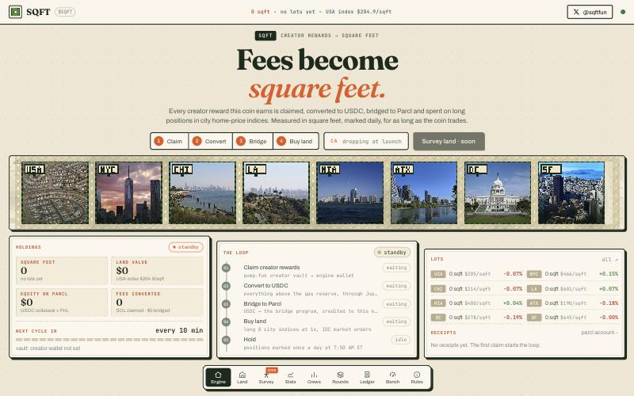
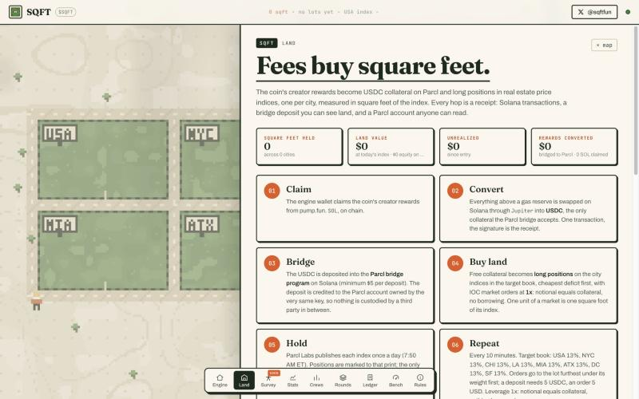

<p align="center">
  
</p>

<h1 align="center">SQFT · $SQFT</h1>

<p align="center"><b>Fees become square feet.</b><br>
A pump.fun coin whose creator rewards are claimed, converted to USDC, bridged to Parcl and turned into long positions on real estate price indices, one per city, measured in square feet of the index. Automatically, every cycle, for as long as the coin trades.<br>
Nothing held by the site. A public receipt at every hop.</p>

<p align="center">
  <a href="https://sqftfun.vercel.app">sqftfun.vercel.app</a> ·
  <a href="https://sqftfun.vercel.app/land">live receipts</a> · <a href="https://sqft-production.up.railway.app/api/engine">api</a> ·
  <a href="https://x.com/sqftfun">@sqftfun</a>
</p>

<p align="center">
  
</p>

---

## What it is

There is no clean way to be long the housing market on Solana: tokenized REITs have no liquidity, fractional-property platforms sell you one building. The one venue that tracks actual home prices is **Parcl**: perpetual futures on Parcl Labs' city indices, quoted in **USD per square foot**, settled in USDC.

SQFT points a pump.fun coin's fee stream at it. The engine wallet owns the coin's creator position. On a timer it:

1. **claims** the creator rewards (SOL),
2. **converts** them on Solana (Jupiter, SOL → USDC, the only collateral the Parcl bridge takes),
3. **bridges** the USDC into Parcl through the bridge program on Solana; the deposit is credited to the Parcl account owned by the same key,
4. **buys land**: free collateral becomes long positions on the city indices in the target book (USA, NYC, Chicago, LA, Miami, Austin, DC, SF by default, equal weight), lot furthest under its weight first, IOC market orders at **1x**, so notional equals collateral and nothing is borrowed,
5. **holds**: one contract unit is one square foot of the index; the index prints once a day (7:50 AM ET) and the positions are marked to it. The engine never sells.

The site shows all of it live: square feet held, land value at today's index, equity on Parcl, the eight lots with their index, daily and 30-day moves, and every transaction with a link to where you can check it yourself.

## Receipts: how to verify it yourself

| Step | Receipt | Where |
|---|---|---|
| Claim | Solana transaction from the pump.fun creator vault to the engine wallet | [solscan.io](https://solscan.io) |
| Convert | Solana transaction of the Jupiter swap (SOL in, USDC out, same wallet) | [solscan.io](https://solscan.io) |
| Bridge | Solana transaction calling the Parcl bridge program; the owner's unclaimed balance on `GET /v1/bridge/state?owner=` | solscan.io, [validator.v4.parcl.co](https://validator.v4.parcl.co/v1/bridge/state) |
| Buy | Parcl transaction hash; the account's positions on `GET /v1/accounts/{id}` | `/land` and the validator |
| Hold | Square feet = position size; value = size × oracle price; the oracle on `GET /v1/oracle/{market}` | `/land`, `GET /api/engine` |

<p align="center">
  
</p>

## The side quest: survey land

`/survey` is a browser pool, shown as **coming soon** and not usable yet. When it opens, your tab will hash `seed ‖ counter` on CPU (Web Workers) and GPU (WebGPU compute), looking for points whose hash starts with `grid size` zero bits. The server verifies each stake with a single hash, credits 2^grid-size points, and splits each round's SOL pot by share of verified work. Payouts are plain SOL transfers once a balance passes the threshold.

---

## Run it

```bash
npm install
node server.js            # http://localhost:8787
```

Out of the box the engine is off (`ENGINE=0`) and reads the public side only: the Parcl markets, the creator vault (if `CREATOR_WALLET` is set) and the Parcl account of `ENGINE_WALLET` if one exists. The browser pool runs in test mode (pots booked, no SOL moves).

### Engine

| Variable | Default | Meaning |
|---|---|---|
| `ENGINE` | `0` | `1` runs the loop |
| `ENGINE_DRY` | `1` | `1` logs what it would do and moves nothing |
| `PRIVATE_KEY` | | engine wallet secret (base58 or JSON array). This key is also the Parcl owner key |
| `ENGINE_WALLET` | | public key of the engine wallet, for read-only mode |
| `CREATOR_WALLET` | | public key whose pump.fun vault is shown before the engine is armed |
| `TOKEN_MINT` | | the coin; with a fee-sharing config the engine distributes the shared vault first |
| `ENGINE_EVERY_MS` | `600000` | cycle length |
| `ENGINE_KEEP_SOL` | `0.02` | gas reserve kept in the wallet |
| `PARCL_ENV` | `mainnet` | `mainnet` or `devnet` |
| `PARCL_MARKETS` | all eight | `USA,NYC,Miami` (equal weight) or `USA:40,NYC:30,Miami:30` |
| `PARCL_LEVERAGE` | `1` | leverage on new orders |
| `PARCL_MIN_BRIDGE_USDC` | `5` | the bridge rejects smaller deposits |
| `PARCL_MIN_ORDER_USD` | `5` | smallest order the engine places |
| `PARCL_MAX_SLIPPAGE_BPS` | `100` | slippage cap on market orders |
| `PARCL_REFERRER` | | optional referrer account id for account creation |
| `RPC_URL` | publicnode | Solana RPC |

The first bridge deposit of at least 5 USDC (plus the 1 USDC activation fee) lets the engine sign `CreateFundedAccount` with the owner key; from then on every cycle bridges what it has and buys land with the free collateral.

### Pool

`ROUND_MS`, `REWARD_SOL`, `PAYOUT_THRESHOLD_SOL`, `MIN_DIFFICULTY`, `TREASURY_SECRET` (set it to pay out for real), `DATA_FILE`.

### Hosting

The frontend is static (`public/`, `vercel.json` included). The API runs anywhere Node 20 runs (`railway.json` included). Point `<meta name="sqft-api">` in `public/index.html` at the API's origin when they are hosted apart.

## Layout

```
server.js          pool server + static hosting; mounts the engine
engine/engine.js   the land engine: claim → convert → bridge → buy → hold
engine/parcl.js    Parcl V4 client: public reads, owner-key signing, the bridge deposit instruction
public/            the site: index.html, style.css, app.js, land.js (the plat map), the pool modules
tools/pixelart.py  brand art (PIL), regenerates the PNGs in public/
vendor/pumpkit     Solana / pump.fun toolkit (claims, swaps, transfers)
```

## Photo credits

The lots on the map show real photographs of each city, from Wikimedia Commons:

- **USA**: [Suburbia by David Shankbone.jpg](https://commons.wikimedia.org/wiki/File:Suburbia_by_David_Shankbone.jpg) · David Shankbone · CC BY-SA 3.0
- **New York City**: [One World Trade Center and New York Sunset.jpg](https://commons.wikimedia.org/wiki/File:One_World_Trade_Center_and_New_York_Sunset.jpg) · ID 2649771 · CC0
- **Chicago**: [Morning view of the downtown skyline from near Morgan Point along Lakefront Trail, Chicago, 2025.jpg](https://commons.wikimedia.org/wiki/File:Morning_view_of_the_downtown_skyline_from_near_Morgan_Point_along_Lakefront_Trail,_Chicago,_2025.jpg) · DimiTalen · CC0
- **Los Angeles**: [Griffith Observatory with Downtown Los Angeles In The Background - 54084315490.jpg](https://commons.wikimedia.org/wiki/File:Griffith_Observatory_with_Downtown_Los_Angeles_In_The_Background_-_54084315490.jpg) · The Fun Chronicles · CC0
- **Miami**: [Miami skyline from Biscayne Bay, Florida LCCN2011634548.tif](https://commons.wikimedia.org/wiki/File:Miami_skyline_from_Biscayne_Bay,_Florida_LCCN2011634548.tif) · Carol M. Highsmith · Public domain
- **Austin**: [Lady Bird Lake in Austin, Texas.jpg](https://commons.wikimedia.org/wiki/File:Lady_Bird_Lake_in_Austin,_Texas.jpg) · Rish0203 · CC0
- **Washington, DC**: [United States Capitol - west front edit.jpg](https://commons.wikimedia.org/wiki/File:United_States_Capitol_-_west_front_edit.jpg) · Architect of the Capitol · Public domain
- **San Francisco**: [San Francisco city skyline.jpg](https://commons.wikimedia.org/wiki/File:San_Francisco_city_skyline.jpg) · Lisafern · CC0

Not financial advice. Perpetual futures carry funding and can be liquidated; at 1x on a daily-marked index that risk is small but not zero. The engine is the only thing that trades, and it only ever buys.
